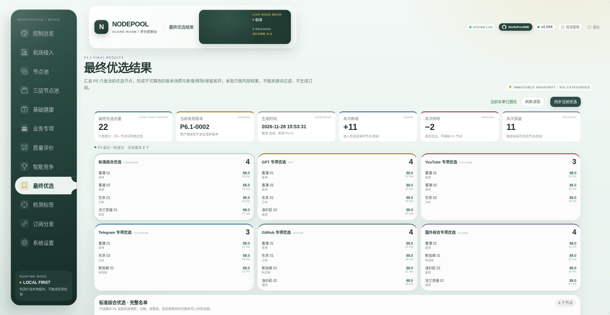
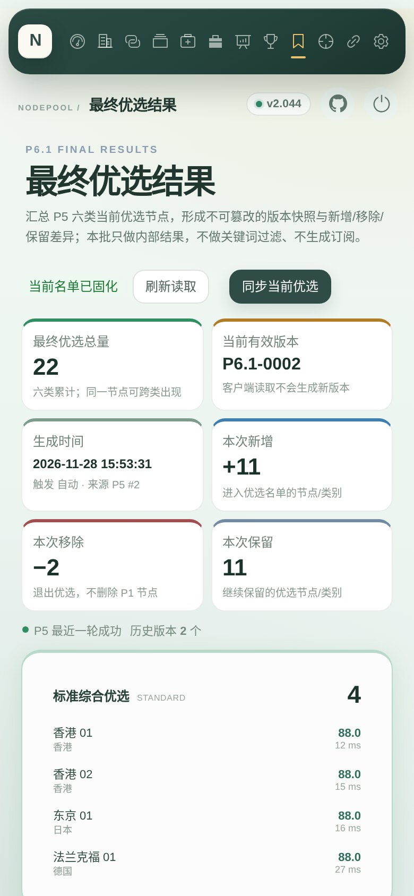
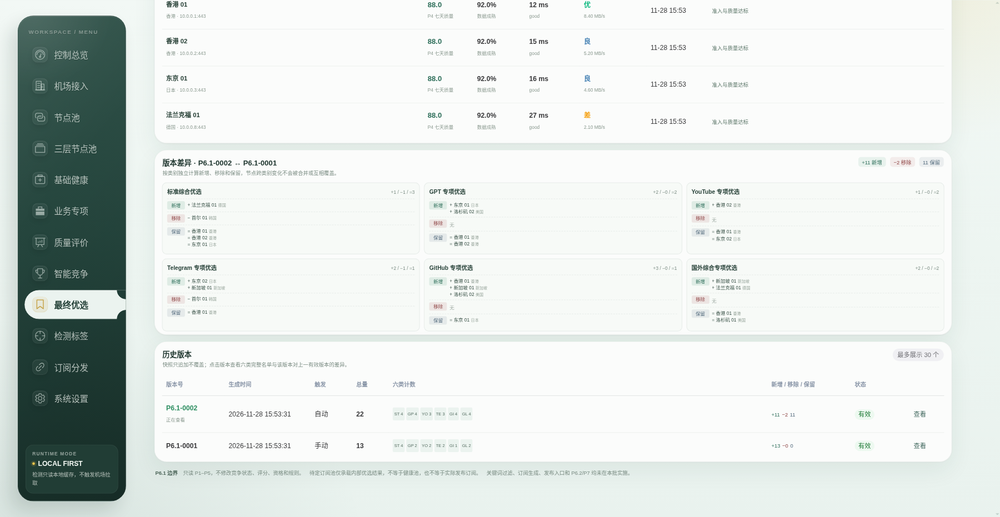
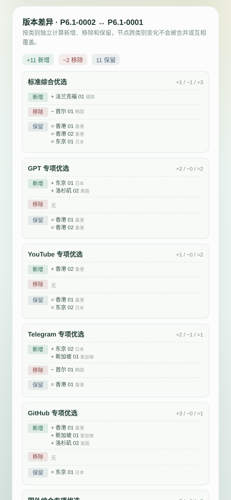
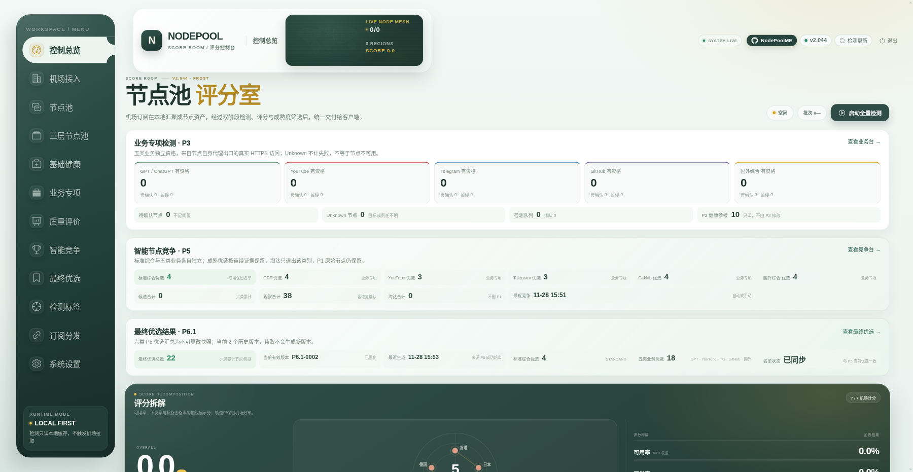

# NodePoolME P6.1 测试与验收记录

## 一、测试环境

- 仓库：`laoXuHome/NodePoolME`
- 基线：P5 `v2.043`（代码 `40bf163`，文档 `f4cfbdb`）
- 本批版本：`v2.044`
- Python：3.12
- 前端：Vue 3 + Vite
- 数据库：SQLite

## 二、自动化测试

### 1. P6.1 专项

命令：

```bash
python -m pytest tests/test_final_p6.py -q
```

结果：`6 passed`。

覆盖：

1. 六类分别正确生成；
2. 同一节点同时出现在六类；
3. 新增、移除、保留按类别准确记录；
4. 类别隔离：GPT 变化不污染 YouTube；
5. 历史版本生成后旧版本内容不变；
6. 重复读取 `current/version` 不生成版本；
7. 成员不变时手动快照返回 `unchanged`，不生成新版本；
8. 有效空版本生成，旧版本节点不被继承；
9. 无 P5 轮次、running、partial 均拒绝，且不覆盖有效版本；
10. 快照不修改 `np5_state`、`np5_history`、`np5_runs`；
11. 变化记录带 `at` 与 `trigger`；
12. Dashboard 读取真实存储，total/version/计数一致。

### 2. P5 + P6.1 联合专项

```bash
python -m pytest tests/test_competition_p5.py tests/test_final_p6.py -q
```

结果：`24 passed in 38.60s`。

P5 18 项原验收测试全部保持通过，证明 P6.1 未改 P5 竞争逻辑。

### 3. 全量回归

```bash
python -m pytest -q
```

结果：

```text
523 passed, 1 skipped, 1 warning in 79.56s
```

原 P5 基线为 517 passed、1 skipped；本批新增 6 项 P6.1 测试，数量与结果一致。无新增失败。

## 三、接口验收

真实启动服务后逐项调用（认证会话）：

| 接口 | 结果 |
|---|---|
| `GET /api/final/summary` | 返回 `P6.1-0002`、历史 2、pending=false、P5 源 success |
| `GET /api/final/versions?limit=5` | 返回 0002、0001，上一版本链正确 |
| `GET /api/final/versions/1` | 返回第一版 13 条，六类计数正确 |
| `GET /api/final/diff` | 六类新增/移除/保留分别返回；变化含 `at/trigger` |
| `POST /api/final/snapshot`（连续两次） | 均返回 `created=false, unchanged`，历史仍为 2 |
| `GET /api/dashboard` | `final_result` 块返回总量 22、版本 0002、五类业务计数 |

## 四、验收场景对照

| 要求 | 证据 |
|---|---|
| 六类优选分别正确生成 | 专项测试 1；页面六类卡与接口计数 |
| 同一节点可跨类 | 专项测试 1；页面香港 01 出现在六类 |
| 新增/移除/保留准确 | 专项测试 2；差异截图 |
| 某类变化不覆盖其他类 | 专项测试 2 类别隔离断言 |
| 无有效变化不生成新版本 | 专项测试 2；接口连续快照 unchanged |
| 有效空版本与旧版区分 | 专项测试 3；`is_empty=1` |
| 无效结果不覆盖上一有效版本 | 专项测试 4；running/partial 均拒绝 |
| 多次读取不生成版本 | 专项测试 2；接口 GET 重复调用 |
| 历史快照不可修改 | 专项测试 2；旧版本详情在 v2 后不变 |
| P1–P5 原功能不变 | 专项测试 5；P5 18 项 + 全量回归通过 |

## 五、界面截图

### 桌面端



### 移动端



### 当前版本与上一版本差异



### 移动端差异



### Dashboard 联动



## 六、发布信息

- Git commit：见交付回复与仓库 `main`
- Tag：`v2.044`
- GitHub Actions：main / tag 构建结果见交付回复
- 离线包：`nodepoolme-v2.044-offline-amd64.tar.gz`，仅 `linux/amd64`
- 镜像：`ghcr.io/laoxuhome/nodepoolme:v2.044`

## 七、验收状态

P6.1 已完成施工并停止，等待验收。未启动 P6.2 / P7。
