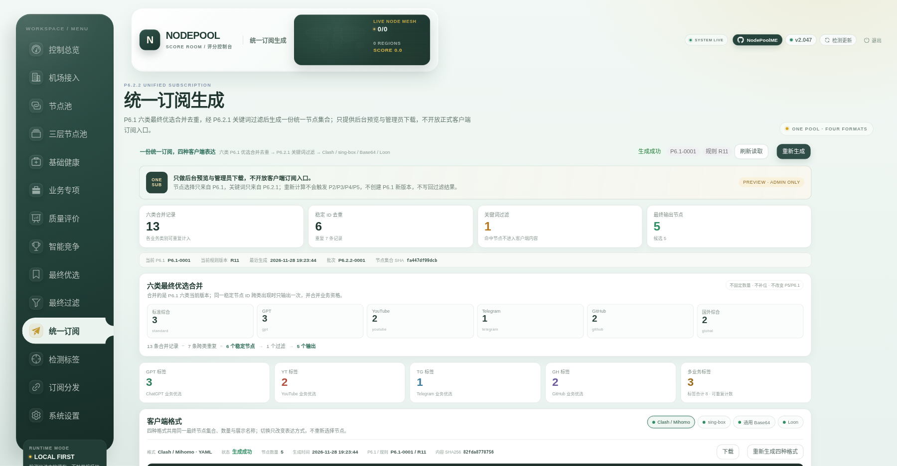
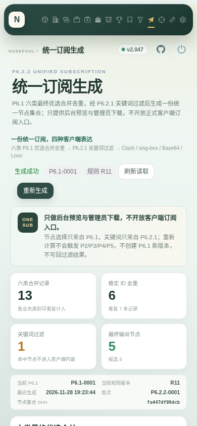
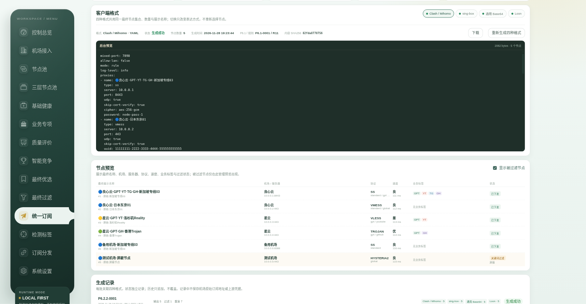
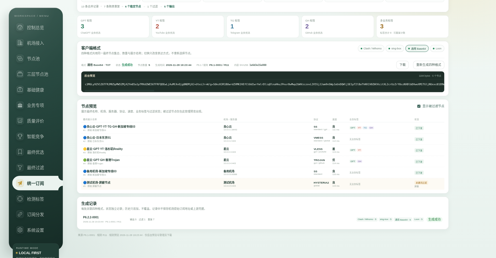
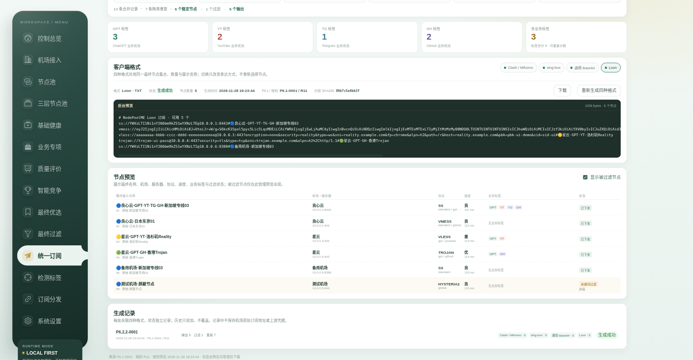
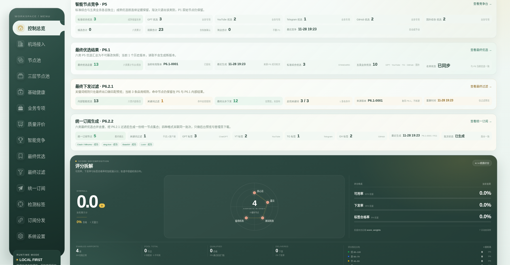

# P6.2.2 测试与验收记录

- 日期：2026-11-28
- 基线：P6.1 + P6.2.1 `v2.046`
- 本批版本：`v2.047`
- 运行环境：Linux / Python 3.12 / Node 前端构建环境
- 代码提交：`a052b9f`

## 一、自动化测试

### 1.1 专项测试

命令：

```bash
python -m pytest tests/test_unified_subscription_p622.py -q
```

结果：`10 passed, 1 warning in 2.09s`

| 用例 | 覆盖 |
| --- | --- |
| `test_merge_dedupe_labels_and_filter` | 12 条合并、6 唯一、6 重复、1 过滤、5 输出；标签顺序与跨类合并；同名不同 ID 不合并 |
| `test_four_formats_same_set_names_and_protocol_params` | 四格式同集合/同数量/同名称；VMess WS/ALPN、VLESS Reality、Trojan 参数保留 |
| `test_duplicate_final_display_name_gets_suffix_in_all_formats` | 同机场同名节点追加 ` #2`；四格式都保留完整后缀，Base64 片段转义正确 |
| `test_format_failure_is_recorded_as_partial_or_failed` | 单格式失败为 `partial`，全失败为 `failed`；真实 `failure_reason`；失败格式不能下载 |
| `test_no_upstream_url_or_credentials_in_content` | 四格式均不含机场 URL、Token、`source_url` |
| `test_rule_or_p6_change_invalidates_old_batch_and_adds_new_batch` | 规则变化后旧批 `stale`、下载拒绝；新批不覆盖旧批；历史顺序正确 |
| `test_unsupported_protocol_is_real_failure_not_silent_or_fake` | TUIC 因 Loon 不支持统一排除并记录原因；四格式仍同数量，不伪造节点 |
| `test_empty_unified_subscription_is_valid_and_recorded` | 空集合标 `empty`；四格式成功生成空结构并通过校验 |
| `test_api_and_dashboard_real_data` | 登录、summary、generate、format、download、Dashboard 真实计数与响应头 |
| `test_stale_download_is_blocked_by_api` | 规则变化后 summary `stale`，下载 409 |

### 1.2 P6.2.1 联合回归

命令：

```bash
python -m pytest tests/test_final_filter_p621.py tests/test_unified_subscription_p622.py -q
```

结果：`17 passed, 1 warning in 2.50s`

### 1.3 全量回归

命令：

```bash
python -m pytest -q
```

结果：`546 passed, 1 skipped, 1 warning in 210.45s`

较 P6.2.1 的 536 passed 增加 10 项，均为本批专项测试。完整输出见 `P6.2.2-全量测试.log`。

### 1.4 构建验证

```bash
python -m compileall -q backend
cd frontend && npm run build
```

结果：后端编译通过；Vite 构建通过，新页面产物 `UnifiedSubscriptionP622-*.js/css` 已生成。

> 运行全量测试前已停止占用演示数据库的本地服务。备份导入用例会扫描同名 `nodepool.db` 句柄，残留服务会导致该组用例误报，这属于测试环境隔离问题，不是业务失败。

## 二、施工中修正的问题

| 问题 | 处理 |
| --- | --- |
| 批次节点命中原因写入 `filter_hits`，读取 `hits_json` 为空 | 统一改为 `hits` |
| `tests/conftest.py` 未清理 `np622_*`，批次 ID 跨用例累积 | 加入 `_P622_TABLES` 每例清理 |
| API 测试登录路径误用 `/api/login` | 改为 `/api/auth/login` |
| 重名后缀 ` #2` 在 Base64 URI 片段被 `rsplit("#")` 截断 | 片段只从第一个 `#` 起取全文；生成时转义 `#`、空格、`%`，并新增重名专项测试 |
| 缺少格式失败状态测试 | 新增 partial/failed 专项测试，断言真实失败原因与不可下载 |

## 三、功能验收对照

| 验收项 | 结果 | 证据 |
| --- | --- | --- |
| 六类正确合并 | 通过 | 专项 1、页面六类卡 13−7=6 |
| 稳定 ID 去重 | 通过 | 专项 1、批次 `unique_count` |
| 跨类标签合并、顺序固定 | 通过 | 专项 1、四格式名称一致 |
| 同名不同 ID 不合并 | 通过 | 专项 1 |
| 重名最终输出不吞节点 | 通过 | 专项 3，四格式均保留 ` #2` |
| 关键词命中不进订阅 | 通过 | 专项 1、6、7、10 |
| 规则/版本变化旧结果失效 | 通过 | 专项 6、10；下载 409 |
| 四格式结构正确 | 通过 | 专项 2、4、8；格式校验函数 |
| 四格式集合/数量/名称一致 | 通过 | 专项 2、3、7、8 |
| 协议参数保留 | 通过 | 专项 2：WS、TLS、ALPN、Reality |
| 不支持协议明确记录 | 通过 | 专项 7；`unsupported_json` |
| 格式失败真实记录 | 通过 | 专项 4 |
| 不泄露机场 URL/凭据 | 通过 | 专项 5 |
| 历史只追加 | 通过 | 专项 6 |
| 空结果正确记录 | 通过 | 专项 8 |
| Dashboard 真实数据 | 通过 | 专项 9 |
| 不触发 P2/P3/P4/P5 | 通过 | P6.2.1 专项与 P6.2.2 只读链路；本批无新增调度器 |
| 后台/移动可用 | 通过 | 桌面 1800×936、移动 390×844 截图 |
| 无公网订阅入口 | 通过 | 仅登录后台与 `download` 管理员接口 |

## 四、页面截图

桌面端：



移动端 390×844：



四种格式实际预览：








Dashboard：



截图数据来自独立演示库 `/tmp/nodepool-p622-ui` 的 P1→P5→P6.1→P6.2.1→P6.2.2 真实链路，不是前端写死数字；页面显示 `v2.047`、批次 `P6.2.2-0001`、P6.1-0001 / R11。

## 五、发布验证

- 代码提交：`a052b9f`
- Tag：`v2.047`
- 主分支 CI：`https://github.com/laoXuHome/NodePoolME/actions/runs/46141186450（test / smoke / build 全部 success）`
- Tag CI：`https://github.com/laoXuHome/NodePoolME/actions/runs/46141194822（test / smoke / build 全部 success）`
- Release：`https://github.com/laoXuHome/NodePoolME/releases/tag/v2.047`
- 镜像：`ghcr.io/laoxuhome/nodepoolme:v2.047`
- amd64 离线包：``nodepoolme-v2.047-offline-amd64.tar.gz`，88,733,956 bytes，SHA256 `93fc50edaecada99192a4f59f60c99ae55f1676829b4a7728620782688d18444``

结论：P6.2.2 功能、自动化、页面与发布链完成，停止施工，等待验收；不进入 P6.3。
